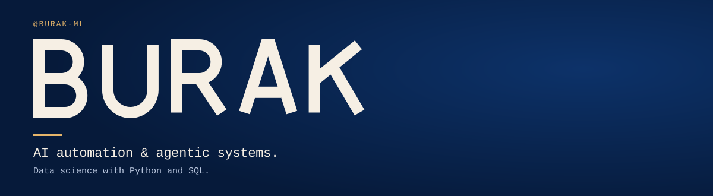
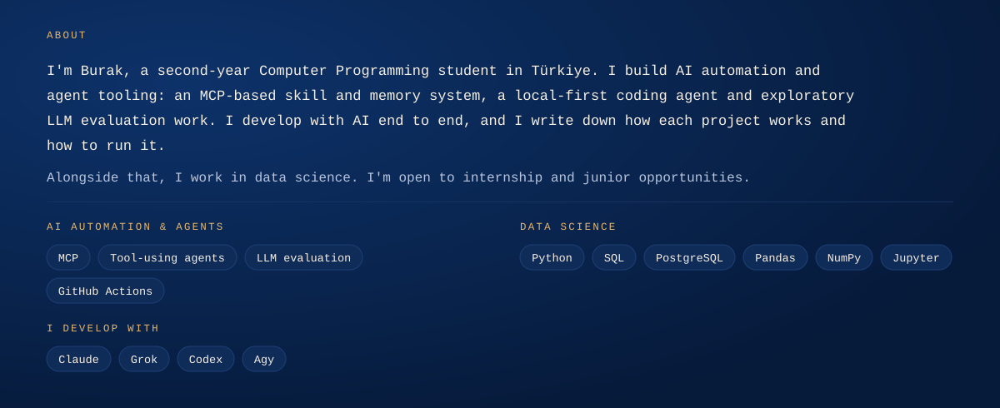

<!--fig-header-->

<!--/fig-header-->

<!--fig-about-->

<!--/fig-about-->

## Selected projects

Selected work: agent tooling and automation first, data projects alongside. Every repo explains how it works and how to run it.

<!--projects-->
<table>
<tr>
<td width="50%" valign="top">

#### [RoveCode_plugins](https://github.com/Burak-ML/RoveCode_plugins)
`TypeScript` · `MCP` · `AI Automation` — 25 stars

An MCP-based skill and memory system that routes AI coding requests to relevant tools, with documented evaluation scripts.

05 Sep 2026 → 25 Oct 2026

</td>
<td width="50%" valign="top">

#### [Rove_cli](https://github.com/Burak-ML/Rove_cli)
`Wails` · `React` · `TypeScript` — 1 star

A local-first coding agent with a shared daemon and desktop interface for sessions, terminal workflows and automations.

17 Sep 2026 → 29 Oct 2026

</td>
</tr>
<tr>
<td width="50%" valign="top">

#### [ModelAudit](https://github.com/Burak-ML/ModelAudit)
`LLM Evaluation` · `Research` · `AI` — 23 stars

An exploratory framework for comparing LLM behavior and documenting model attribution hypotheses; not a definitive identity test.

12 Sep 2026 → 25 Oct 2026

</td>
<td width="50%" valign="top">

#### [SearchForge_open](https://github.com/Burak-ML/SearchForge_open)
`Python` · `FastAPI` · `Next.js` · `Google Drive` — 4 stars

A document search and PDF reading application connecting Google Drive with a Python backend, keyword search and caching.

27 Aug 2026 → 25 Oct 2026

</td>
</tr>
<tr>
<td width="50%" valign="top">

#### [fast_f1_data](https://github.com/Burak-ML/fast_f1_data)
`Python` · `SQL` · `PostgreSQL` · `FastAPI` — 5 stars

A Formula 1 data analysis app using SQL queries, a Python API and interactive driver, team and lap comparisons.

01 Jul 2026 → 30 Oct 2026

</td>
<td width="50%" valign="top">

#### [KeyLingo](https://github.com/Burak-ML/KeyLingo)
`Python` · `macOS` · `DeepL API` — 2 stars

A Python utility for translating active text between Turkish and English using global keyboard shortcuts on macOS.

15 Sep 2026 → 25 Oct 2026

</td>
</tr>
</table>
<!--/projects-->

<b>Türkçe</b>

Merhaba, ben **Burak**. Bilgisayar Programcılığı 2. sınıf öğrencisiyim. **Yapay zekâ otomasyonu ve ajan (agent) araçları** geliştiriyorum: MCP tabanlı bir skill ve hafıza sistemi, yerel çalışan bir kodlama ajanı ve keşif amaçlı LLM değerlendirme çalışmaları. Projeleri baştan sona yapay zekâyla geliştiriyorum; her projenin nasıl çalıştığını ve nasıl çalıştırılacağını yazıyorum.

Bunun yanında **veri bilimi** ile ilgileniyorum: **Python, SQL, PostgreSQL, Pandas** ve veri analizi. Staj ve junior fırsatlarına açığım.

## Contact

You can explore my work here on [GitHub](https://github.com/Burak-ML). Open to conversations about **AI automation, agentic systems and data science**.
