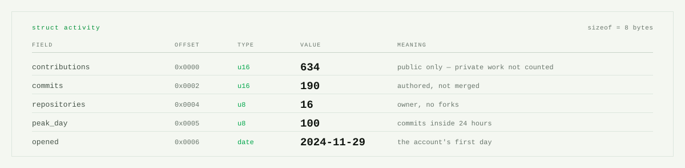
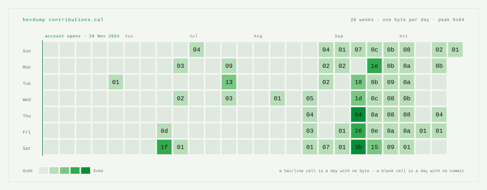
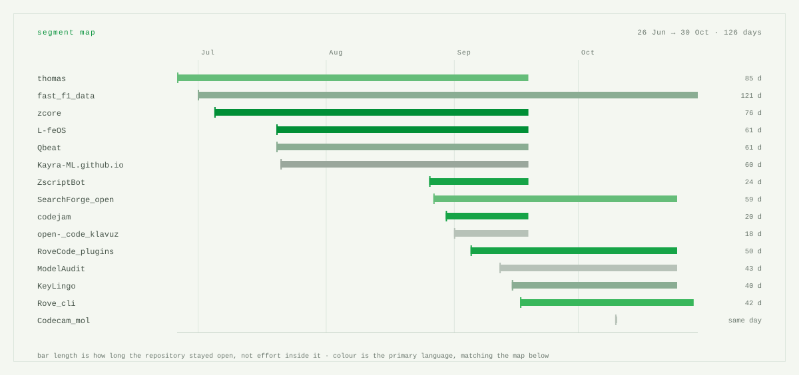
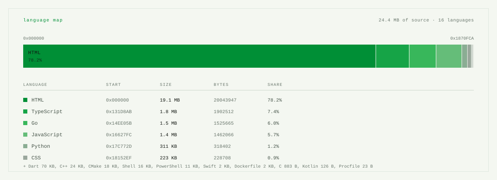

<!--fig-header-->
<picture>
  <source media="(prefers-color-scheme: dark)" srcset="assets/header-dark.svg">
  
</picture>
<!--/fig-header-->

## About me

I'm **Burak**, a second-year Computer Programming student in Türkiye, currently looking for internship and junior opportunities.

I work primarily with **Python, SQL and data analysis**. Alongside data projects, I build **APIs, developer tools and AI-assisted automation systems**. I enjoy understanding a problem, designing a practical solution and documenting how it works.

### Focus & tools

- **Data & analysis:** Python, SQL, PostgreSQL, Pandas, NumPy, Jupyter
- **Backend development:** FastAPI, REST APIs, Git
- **Automation & tooling:** MCP, TypeScript, GitHub Actions

<!--fig-fields-->
<picture>
  <source media="(prefers-color-scheme: dark)" srcset="assets/fields-dark.svg">
  
</picture>
<!--/fig-fields-->

<!--fig-calendar-->
<picture>
  <source media="(prefers-color-scheme: dark)" srcset="assets/calendar-26w-dark.svg">
  
</picture>
<!--/fig-calendar-->

## Selected projects

A few public projects chosen for their relevance to data, Python development and automation. Each repository has technical details and setup instructions.

<!--projects-->
<table>
<tr>
<td width="50%" valign="top">

#### [fast_f1_data](https://github.com/KAYRA-ML/fast_f1_data)
`Python` · `SQL` · `PostgreSQL` · `FastAPI` — 5 stars

A Formula 1 data analysis app using SQL queries, a Python API and interactive driver, team and lap comparisons.

0x00 · 01 Jul 2026 → 25 Oct 2026

</td>
<td width="50%" valign="top">

#### [SearchForge_open](https://github.com/KAYRA-ML/SearchForge_open)
`Python` · `FastAPI` · `Next.js` · `Google Drive` — 4 stars

A document search and PDF reading application connecting Google Drive with a Python backend, keyword search and caching.

0x01 · 27 Aug 2026 → 25 Oct 2026

</td>
</tr>
<tr>
<td width="50%" valign="top">

#### [RoveCode_plugins](https://github.com/KAYRA-ML/RoveCode_plugins)
`TypeScript` · `MCP` · `AI Automation` — 25 stars

An MCP-based skill and memory system that routes AI coding requests to relevant tools, with documented evaluation scripts.

0x02 · 05 Sep 2026 → 25 Oct 2026

</td>
<td width="50%" valign="top">

#### [ModelAudit](https://github.com/KAYRA-ML/ModelAudit)
`LLM Evaluation` · `Research` · `AI` — 23 stars

An exploratory framework for comparing LLM behavior and documenting model attribution hypotheses; not a definitive identity test.

0x03 · 12 Sep 2026 → 25 Oct 2026

</td>
</tr>
<tr>
<td width="50%" valign="top">

#### [Rove_cli](https://github.com/KAYRA-ML/Rove_cli)
`Wails` · `React` · `TypeScript` — 1 star

A local-first coding agent with a shared daemon and desktop interface for sessions, terminal workflows and automations.

0x04 · 17 Sep 2026 → 29 Oct 2026

</td>
<td width="50%" valign="top">

#### [KeyLingo](https://github.com/KAYRA-ML/KeyLingo)
`Python` · `macOS` · `DeepL API` — 2 stars

A Python utility for translating active text between Turkish and English using global keyboard shortcuts on macOS.

0x05 · 15 Sep 2026 → 25 Oct 2026

</td>
</tr>
</table>
<!--/projects-->

<!--fig-segments-->
<picture>
  <source media="(prefers-color-scheme: dark)" srcset="assets/segments-dark.svg">
  
</picture>
<!--/fig-segments-->

<!--fig-langs-->
<picture>
  <source media="(prefers-color-scheme: dark)" srcset="assets/langs-dark.svg">
  
</picture>
<!--/fig-langs-->

## What the charts show

The figures are generated from GitHub activity by [`build.py`](build.py) and [GitHub Actions](.github/workflows/refresh.yml). Language proportions reflect repository file sizes, **not skill levels**. Work in private repositories may not appear.

## Türkçe

Merhaba, ben **Burak**. Bilgisayar Programcılığı 2. sınıf öğrencisiyim ve veri analizi, Python geliştirme ve otomasyon alanlarında staj veya junior iş fırsatları arıyorum.

**Python, SQL, PostgreSQL, Pandas** ve API geliştirme üzerine çalışıyorum. Veri analizi projelerinin yanında yapay zekâ destekli otomasyonlar ve geliştirici araçları da geliştiriyorum. Önemsediğim şey yalnızca çalışan bir proje yapmak değil; neden o yaklaşımı seçtiğimi ve nasıl çalıştığını açıklayabilmek.

## Contact

You can explore my work here on [GitHub](https://github.com/Kayra-ML). Open to conversations about **data analysis, Python development and automation**.
